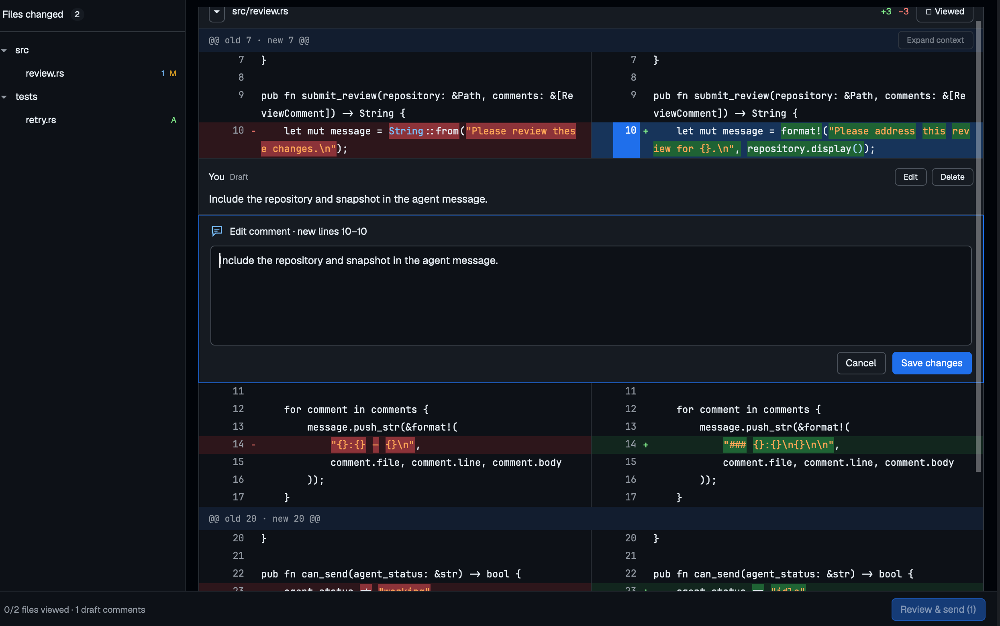

# Changes

A native code-review tab for [Herdr](https://herdr.dev), inspired by GitHub's
**Files changed** view. Review all current uncommitted changes, leave comments
beside the code, then send one feedback batch to your coding agent.



## What it does

- **Cmd+Shift+R** opens a review immediately beside the focused agent's tab.
  Reopening returns to the same tab. Repository and recipient stay pinned.
- A changed-file tree navigates stacked, collapsible diff cards. Clicking a file
  expands it, aligns its header to the top (even the last file), and outlines
  the entire card in blue until another file is selected. Drag the tree's right
  divider to resize it, or use Herdr's sidebar icon to collapse/restore it.
  The last expanded width and collapsed state persist across Review tabs and
  app restarts, independently of the repository.
- Modified files use **split** diffs; new/deleted files use a single column.
  [Difftastic](https://github.com/Wilfred/difftastic) supplies structural alignment
  and changed-token highlights, with a Git text fallback.
- Click a line or line number for a persistent blue outline. Hovering another
  line independently reveals its blue **+**. Click + to open an inset comment
  card. Shift-click lines or **+** for a range. Saved drafts can be edited/deleted
  and survive restarts.
- Viewed checkboxes track progress with immediate per-file updates, without
  flickering other controls.
- Gutter arrows reveal up to ten unchanged lines above/below a hunk, or from
  either end of a gap between hunks in the same file. Expansions stay on the
  frozen snapshot, join hunks when they meet, and stop at file boundaries.
- Changes arriving while you type never move your comment anchors. Outdated
  drafts retain their original quotes and snapshots.
- **Review & send** previews the exact message before pasting/submitting it to
  the originating idle agent. Nothing is sent automatically.

This is strictly a reviewer: no staging, commits, pushing, merging or GitHub API
integration. There is no repository/scope toolbar or view-mode picker. It reviews
HEAD against the current working tree, including untracked files—not only edits
made by the agent.

## Requirements

- Herdr **0.1.13** and herdr-core on PATH (tested version).
- Git and Rust/Cargo (backend declares Rust 1.85+).
- Difftastic **0.72.0** for the tested structural JSON adapter. Other versions
  fall back to text diffs rather than relying on an unstable output format.
- macOS is tested; the Unix launcher also uses `env`. Windows launching is not tested.
- Node 22+ is needed only for UI tests, not to run a Herdr mod.

## Install

Clone this repository, then install its two mods and Rust helper:

```sh
git clone https://github.com/ddritzenhoff/herdr-changes.git
cd herdr-changes
brew install difftastic # macOS, if not already installed
sh scripts/install.sh
```

`HERDR_APP_HOME` selects the destination (default `~/.config/herdr-app`). The
installer builds/checks the code and refuses existing component directories.
Use `sh scripts/install.sh --update` to replace a previous installation; old
components are backed up under Herdr's `data/changes-install-backups/` first.
It never copies code snapshots, drafts, terminal data or unrelated dotfiles.
It does **not** overwrite your layout or shortcuts.

### Enable the launcher in your layout

1. If using a shipped layout, duplicate it first. For example:

   ```sh
   herdr-app do layout.clone '{"name":"main","as":"changes-layout"}'
   ```

   Skip duplication if you already have a personal layout.

2. In that personal `layouts/<name>.json`, change the tab bar's mod reference
   from `"mod": "tabs"` to `"mod": "review-tabs"`. Do not replace the terminal
   block, Changes panel, or the whole layout. If you already customized the tab
   bar, merge the launcher rather than discarding your custom code.

3. Merge the binding from this repo's `keys.json` into your existing keys file:

   ```json
   "cmd-shift-r": "review-tabs.open"
   ```

   Do not replace your entire keys file. Choose another chord if this one is used.
   On non-Mac systems, bind your preferred key to the same command.

4. Check `herdr-app status`, focus a local agent terminal and use the shortcut.

The existing Herdr Changes/Files panels remain available. Closing a review tab
does not stop its agent. If the agent's launch directory is not a Git repository,
start it in the repository you want to review; there is no repository selector.

## Safety and current limits

- Code, snapshots, drafts, viewed state and sent archives stay in Herdr's private,
  Git-ignored `data/review/` directory. Nothing is uploaded by this mod. Only an
  explicit Send hands the prepared message to the chosen agent's terminal.
- Sending uses `hc send --if idle`, never force-send. Paste + Enter is not an
  acknowledgement from the model; verify receipt, especially for large reviews.
- Saved drafts survive restarts. Unsaved textarea text survives scrolling but
  not closing/reloading the mod. Save it before closing.
- Local repositories/agents only. No binary/image previews, full unchanged-code
  syntax highlighting, threaded replies, file/hunk comments or queued delivery.
- Renames appear as delete/add. Limits include 1,000 changed files, 512 KiB and
  12,000 lines per file, 50 lines per selection, 100 drafts and 48 KiB per batch.

See [the implementation guide](tools/review-backend/README.md) for snapshot,
concurrency, transport and storage details.

## Source and tests

```text
mods/review/             Native GPUI review UI (JavaScript)
mods/review-tabs/        Herdr tab-bar clone with review launcher
tools/review-backend/    Rust Git/diff/storage/message backend
tests/                  UI/model/launcher/transport tests
```

The UI is JavaScript because Herdr exposes that mod API; rendering is native,
not HTML/Electron. Git, Difftastic integration and persistent review logic are Rust.

```sh
npm test
cargo test --locked --manifest-path tools/review-backend/Cargo.toml -- --include-ignored
cargo clippy --locked --manifest-path tools/review-backend/Cargo.toml --all-targets -- -D warnings
```

The ignored-by-default Rust test exercises the real Difftastic 0.72.0 adapter.
Tests do not send feedback to real agents. The screenshot uses synthetic example
code, not a user's repository or conversation.

## License

Original reviewer/backend code is MIT licensed. The cloned Herdr tab bar and
reused sidebar icon retain their Apache-2.0 license. See [LICENSE](LICENSE) and
[THIRD-PARTY-NOTICES](THIRD-PARTY-NOTICES).
GitHub's layout is a visual reference only; no GitHub Desktop source or branding
is included. Difftastic and Herdr are separate dependencies, not bundled binaries.
